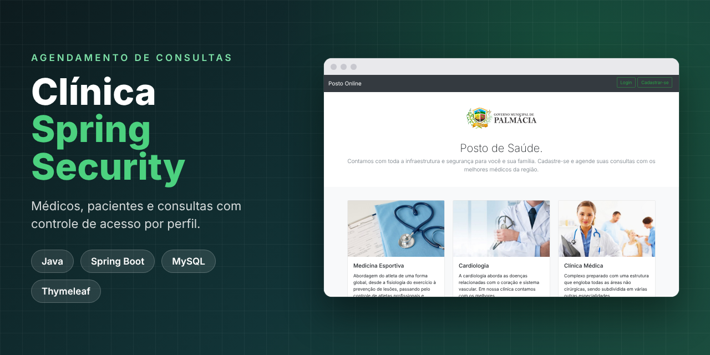
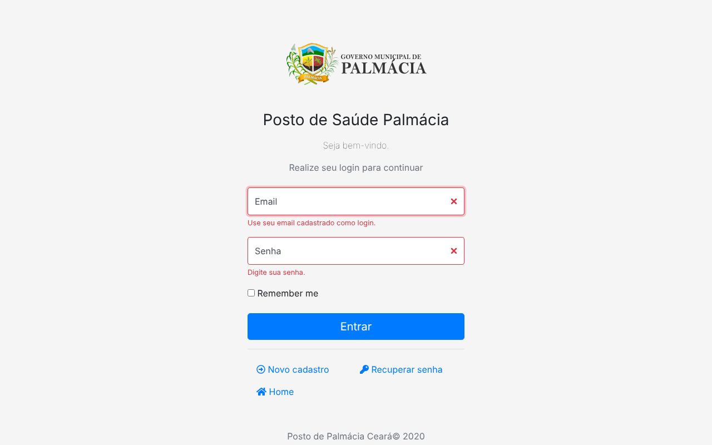
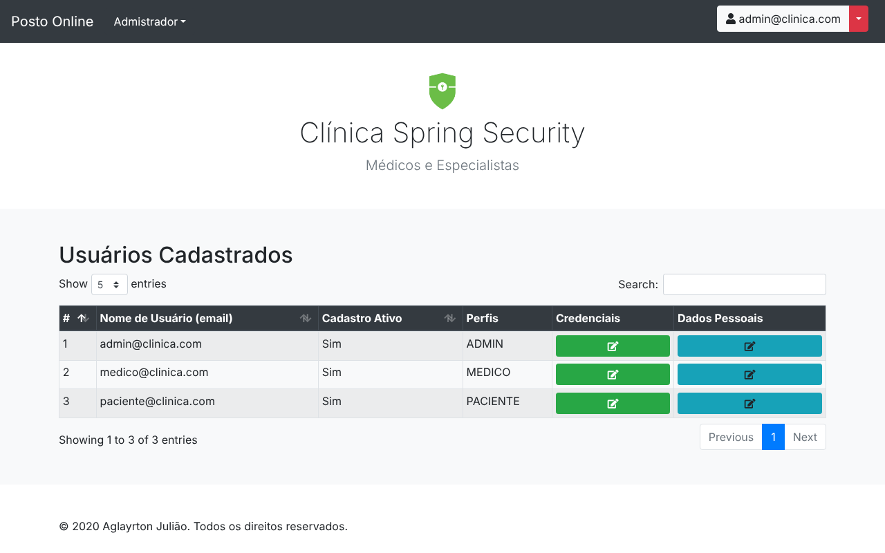
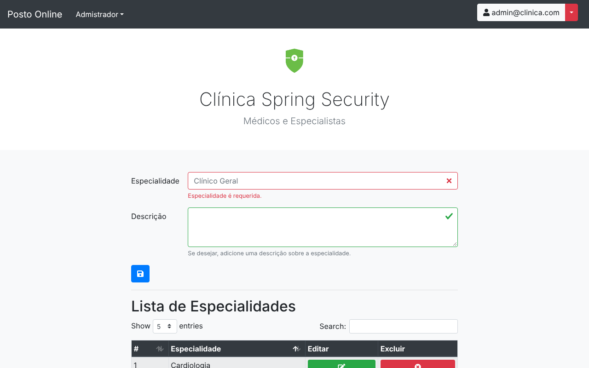
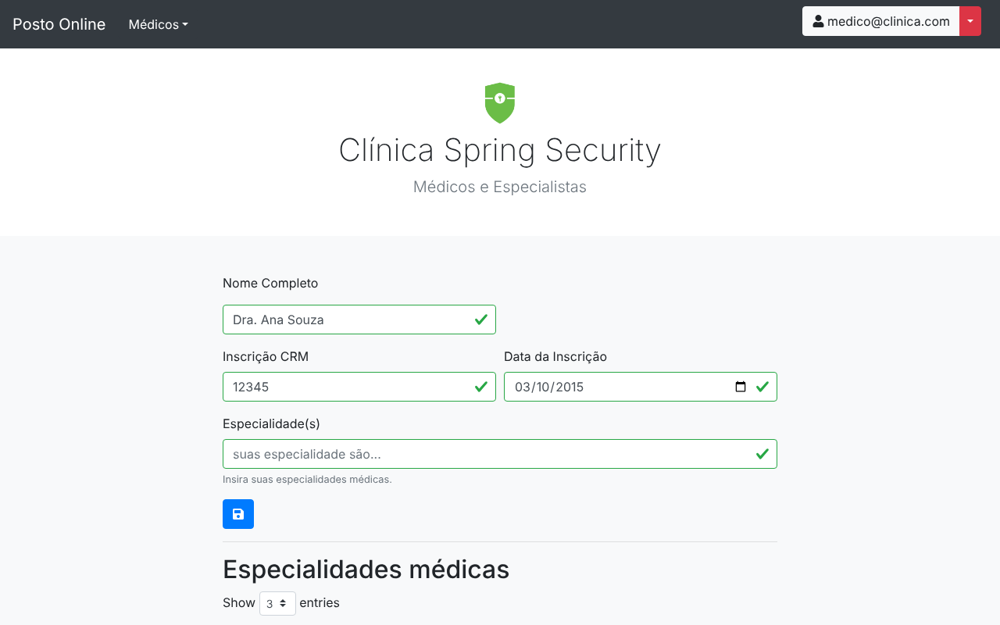
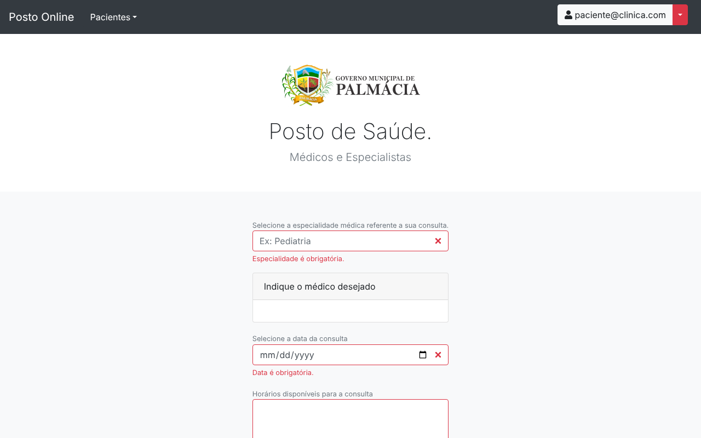

<p align="center">
  
</p>

<h1 align="center">🏥 Clínica Spring Security</h1>

<p align="center">
  Sistema web de uma clínica (posto de saúde) para <b>agendamento de consultas</b>, com médicos, pacientes e
  especialidades e <b>controle de acesso por perfil</b> feito com <b>Spring Security</b>.
</p>

<p align="center">
  
  
  
  
  
  
</p>

<p align="center">
  <a href="#-sobre-o-projeto">Sobre</a> •
  <a href="#-funcionalidades">Funcionalidades</a> •
  <a href="#-telas">Telas</a> •
  <a href="#-como-executar">Como executar</a> •
  <a href="#-testes">Testes</a> •
  <a href="#-estrutura-do-projeto">Estrutura</a>
</p>

---

## 📌 Sobre o projeto

Aplicação web monolítica em **Spring Boot** que simula um posto de saúde com agendamento de consultas online.
O foco do projeto é o **Spring Security**: autenticação com senha criptografada (BCrypt), autorização por perfil
(**ADMIN**, **MÉDICO** e **PACIENTE**) tanto nas rotas do back-end quanto nos elementos das telas
(Thymeleaf Extras Spring Security), página de acesso negado e "lembrar de mim".

O sistema é dividido em camadas no padrão **MVC**:

- **Domain:** entidades JPA (`Usuario`, `Perfil`, `Medico`, `Paciente`, `Especialidade`, `Horario`, `Agendamento`).
- **Repository e Service:** acesso ao banco com Spring Data JPA e as regras de negócio.
- **Controller:** navegação das telas e endpoints usados via AJAX.
- **Config:** `SecurityConfig` (estende `WebSecurityConfigurerAdapter`), onde ficam as regras de acesso de cada rota.

## ✨ Funcionalidades

| | Recurso | Descrição |
|---|---|---|
| 🔐 | **Login seguro** | Senhas com BCrypt, sessão do Spring Security, "lembrar de mim" e página de acesso negado |
| 🧑‍⚕️ | **Perfis de acesso** | `ADMIN`, `MEDICO` e `PACIENTE`, com rotas e menus diferentes para cada um |
| 👥 | **Gestão de usuários** | O admin cadastra usuários, edita credenciais, ativa/desativa contas e define os perfis |
| 🩺 | **Especialidades** | Cadastro, edição e exclusão de especialidades médicas (admin) |
| 📋 | **Dados do médico** | O médico informa nome, CRM, data de inscrição e as suas especialidades |
| 📅 | **Agendamento** | O paciente escolhe a especialidade, o médico, a data e um dos horários livres |
| 🕘 | **Histórico** | Paciente e médico veem o histórico de consultas, com edição e exclusão |
| 📝 | **Cadastro de paciente** | Autocadastro com código de confirmação enviado por e-mail |
| 🔑 | **Recuperar senha** | Redefinição de senha com código enviado por e-mail (JavaMail) |
| ⚡ | **AJAX e DataTables** | Listas paginadas no servidor e busca de horários sem recarregar a página |

## 🖼️ Telas

<table>
  <tr>
    <td align="center"><b>Página inicial</b><br></td>
    <td align="center"><b>Login</b><br></td>
  </tr>
  <tr>
    <td align="center"><b>Usuários (admin)</b><br></td>
    <td align="center"><b>Especialidades (admin)</b><br></td>
  </tr>
  <tr>
    <td align="center"><b>Dados do médico</b><br></td>
    <td align="center"><b>Agendar consulta (paciente)</b><br></td>
  </tr>
</table>

<sub>Prints feitos com a aplicação rodando localmente sobre o <code>script-mysql.sql</code>, mais alguns usuários,
especialidades e um médico de exemplo inseridos só para a demonstração.</sub>

## 🚀 Como executar

**Pré-requisitos:** JDK 14 ou superior, Maven e MySQL.

1. **Clone o repositório:**

   ```bash
   git clone https://github.com/kauaxp77/Clinica-Spring.git
   cd Clinica-Spring
   ```

2. **Crie o banco:** execute o [`script-mysql.sql`](script-mysql.sql). Ele cria o banco `demo_security`, as tabelas,
   os perfis (`ADMIN`, `MEDICO`, `PACIENTE`) e os horários de consulta. Não há usuários no script.

   ```bash
   mysql -u root -p < script-mysql.sql
   ```

3. **Configure a conexão** em `src/main/resources/application.properties`. Por padrão a aplicação usa
   `jdbc:mysql://localhost:3308/demo_security` com o usuário `root` sem senha; ajuste a porta, o usuário e a senha
   do seu MySQL. Para o envio de e-mails, configure as propriedades `spring.mail.*` com a sua conta SMTP.

4. **Compile e rode:**

   ```bash
   mvn -DskipTests package
   java -jar target/demo-security-0.0.1-SNAPSHOT.jar
   ```

   Acesse `http://localhost:8080`.

> 💡 Como a propriedade `spring.mail.test-connection=true` testa o servidor de e-mail na inicialização, a aplicação
> só sobe com um SMTP válido. Para rodar sem e-mail, desligue esse teste:
> `java -jar target/demo-security-0.0.1-SNAPSHOT.jar --spring.mail.test-connection=false`.

O primeiro usuário **ADMIN** precisa ser criado direto no banco (tabelas `usuarios` e `usuarios_tem_perfis`), com a
senha gravada em **BCrypt**. Pela tela "Cadastrar-se" é possível criar pacientes, que são ativados pelo código
enviado por e-mail.

## ✅ Testes

O projeto tem um teste de contexto (`DemoSecurityApplicationTests`) que sobe a aplicação inteira, então ele precisa
do MySQL configurado no `application.properties`:

```bash
mvn test
```

## 📁 Estrutura do projeto

```
Clinica-Spring/
├── src/main/java/com/mballem/curso/security/
│   ├── config/              # SecurityConfig: regras de acesso por perfil
│   ├── converter/           # Conversores de perfis e especialidades nos formulários
│   ├── datatables/          # Paginação e ordenação no servidor para o DataTables
│   ├── domain/              # Entidades JPA
│   ├── exception/           # Exceção de acesso negado
│   ├── repository/          # Spring Data JPA
│   ├── service/             # Regras de negócio e envio de e-mails
│   └── web/                 # Controllers e tratamento de exceções
├── src/main/resources/
│   ├── templates/           # Telas Thymeleaf (layout, fragments, agendamento, médico, paciente, usuário)
│   ├── static/              # CSS, imagens e JavaScript das telas
│   └── application.properties
├── src/test/java/           # Teste de contexto
├── docs/
│   ├── banner.png
│   └── screenshots/         # Capturas de tela usadas neste README
├── script-mysql.sql         # Criação do banco, tabelas, perfis e horários
└── pom.xml
```

## 🛠️ Tecnologias

- **Java 14** e **Spring Boot 2.3** (Web, Data JPA, Mail, DevTools)
- **Spring Security** e **Thymeleaf Extras Spring Security 5**
- **MySQL** (driver `mysql-connector-java`)
- **Thymeleaf** com **Layout Dialect**
- **Bootstrap 4**, **jQuery**, **DataTables** e **WebJars**
- **Apache Commons Lang 3**
- **JUnit 5** e **Spring Boot Test**

## 👨‍💻 Autor

Desenvolvido por **[kauaxp77](https://github.com/kauaxp77)**

<p align="center">⭐ Se curtiu o projeto, deixe uma estrela!</p>
